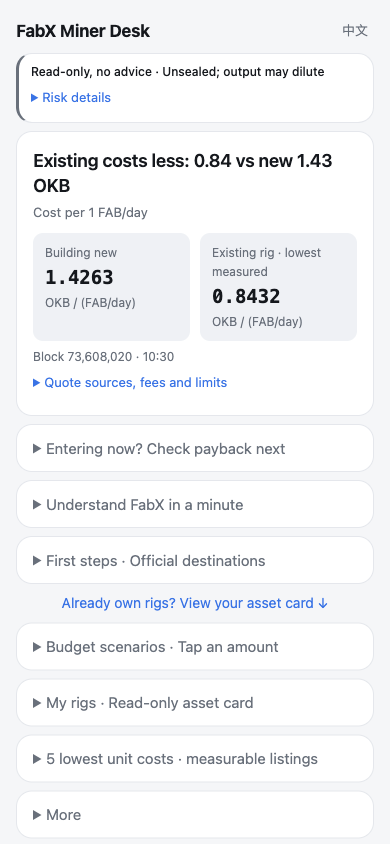

# FabX Miner Desk

[](LICENSE)

**English** · [中文](README.zh.md)

A read-only dashboard for FabX miners on X Layer: compare build-versus-buy costs, measure rig output, and explore payback scenarios.

**[Open the live app](https://fabx-miner-desk.pages.dev/)** · [Product scope](PRODUCT.md) · [Changelog](CHANGELOG.md)

Built as an entry in the **X Layer TapeOut Developer Acceleration Program**.

## What you get

- **Build or buy** — compare the modeled cost of building 1 FAB/day with measurable official rig listings, in OKB per FAB/day.
- **Rig asset cards** — inspect an address's confirmed rigs, pending rewards, measured daily output, and replacement-cost estimates.
- **Payback scenarios** — vary FAB price and network growth, with static gross APR and explicit assumptions.
- **Bilingual newcomer guide** — English/Chinese explanations, upfront contract risks, and official ecosystem links, usable without a wallet.
- **Traceable numbers** — sources, blocks, observation times, cache age, and coverage; unavailable values stay unknown.
- **Optional custom rules** — empty and disabled by default, stored in your browser; no strategy preset or automatic execution.

## How it works

```text
Public X Layer contracts + reference prices
    → pinned state reads + approximately ten-minute reward differences
    → build/buy comparison + static payback scenarios
Optional public address → confirmed rig ownership → rig asset card
```

Open the homepage for the entry comparison. Expand **Entering now? Check payback next** to explore assumptions. Under **Already own rigs?**, paste an address or use the built-in public example to see its asset card.



First-screen capture from **2026-10-19**, at 390 × 844. Prices and output in all screenshots are historical examples, not current quotes. The hosted version can differ from this checkout. See the [Chinese first screen](docs/screenshots/newbie-mobile-v2.png) and [rig asset card: public example address, not the author's holdings, historical snapshot](docs/screenshots/asset-card-mobile-v3.png).

### Contract reads and price sources

The app reads FabX's TapeOut-based circuits and mining system on **X Layer, chain ID 196**. It deploys no contracts. Configuration lives in [desk.mjs](desk.mjs) and [nand-price.mjs](nand-price.mjs).

| Contract / reference | Address | Read path |
| --- | --- | --- |
| FabX mining | `0x4f6a2312d80753bdafd35ddb1bf4bb14c43f8265` | `totalVerifWeight`, `minerCount`, `isSealed`, `minerKey`, `pendingWithDeweb`, `getMiner`, `dewebWeights`, `currentRate`, `UNVERIFIED_BPS` |
| FabX circuit NFTs | `0x87bfca3494aa228ff589ab9b642143a5e8c8f9a6` | `balanceOf`, `nextId`, `ownerOf` at a pinned block |
| Official rig market | `0x0bc37f95ae57bb20e995d425d46d6df9f22bd7a1` | `nextListingId` and `listingView`; rank only after a complete scan |
| NAND / LATCH market | `0x7f955c233fdb17e98fb26f330d778d3e30fe6ee6` | `nextAskId` and `asks`; filter the exact NAND collection and token ID |
| Genesis NAND collection | `0xbe6f94115d32f3ac3252bc4626573e739beeb714` | Match token ID `0` in the ask book |
| Uniswap v4 PoolManager | `0x360e68faccca8ca495c1b759fd9eee466db9fb32` | `extsload(bytes32)` for FAB/BEM Slot0; optional swap logs |
| Multicall3 | `0xca11bde05977b3631167028862be2a173976ca11` | Batch read-only calls with `tryAggregate(false, calls)` |
| BEM price reference (**BSC**) | `0x3098d7a051045000d68ec0360753a40c8cabea31` | Public DexScreener pair quote for BEM/USD |

FAB/BEM pool ID: `0x63556b8d29b7ada6effae8b336cb806a06caf6546b33059b1e5e8b93a98cb29d`.

State reads use public X Layer RPC endpoints; optional swap logs use a separate public endpoint. BEM/USD comes from DexScreener; OKB/USD uses the public OKX OKB-USDT ticker as a USD approximation. The browser reads ownership on chain. Node callers may use the public FabX API for candidate IDs, but must verify ownership on chain.


### Data definitions

| Display | Calculation and boundary |
| --- | --- |
| FAB price | Slot0 FAB/BEM multiplied by BEM/USD. Both pool currencies have 8 decimals; currency0 is BEM, so BEM per FAB is `1 / (sqrtPriceX96 / 2**96)**2`. This is a reference, not an executable quote. |
| NAND price | Lowest positive open ask in the completely decoded NAND book, with quantity at that price. Manual and cached quotes are labeled. Depth may be insufficient for a whole portfolio. |
| Rig output | `pendingWithDeweb` difference across about ten minutes, multiplied by `86400 / actual elapsed seconds`. Claims, sentinel values, missing history, changed state, and failed rate checks stay unknown. |
| Pending rewards | A total is shown only when ownership discovery is complete and every rig's current pending balance is read successfully. Otherwise, show the known subtotal with `n/m` rigs or unknown. Pending coverage is independent of measurable-output coverage. |
| New-build cost | Uses on-chain `currentRate` (the production reader's `emissionRate`) and `UNVERIFIED_BPS` (`unverifiedBps`) at the same block as the listings to calculate actual verified FAB/day, with the contract's integer split and 8-decimal FAB units. Each NAND equivalent assumes 600 verified weight. For 1 FAB/day, NAND required is `networkNand / (verifiedFabPerDay - 1)`, including added-weight dilution. If actual emission cannot be read, the assumption is labeled unverified and no cheaper option is declared. Actual construction uses discrete quantities and may have other costs. |
| Listing unit cost | Official listing OKB divided by measured FAB/day. Pending rewards are not subtracted. |
| Asset value | Measured production converted to NAND equivalents at replacement cost; neither purchase cost nor resale value. Only measurable discovered rigs contribute. |
| APR / payback | Static gross estimates from current production, reference prices, and modeled cost. Future dilution, fees, gas, and price changes are excluded. Future-output scenarios label unmeasured growth assumptions. |

The entry build/buy comparison uses actual emission as described above. Asset replacement values, network-share percentages, and the separate static payback/output scenarios still assume 7,128 verified FAB/day (7,200 × 99%); that assumption is not evidence of current on-chain emission.

Complete listing enumeration is required before ranking. Wallet completeness requires distinct `ownerOf` confirmations to equal `balanceOf` at the same block; partial results are labeled. Cached observations retain their original time and price provenance.

## Setup

```sh
git clone https://github.com/runesleo/fabx-miner-desk.git
cd fabx-miner-desk
```

This is static HTML and native ES modules. No package installation, build step, application backend, or API key is required. You can also download the source archive.

**Any AI coding agent:** start with [PRODUCT.md](PRODUCT.md), the contract/data definitions above, and [test/](test/). The offline self-check is `node --test`; no agent framework is required.

## Requirements

- A modern browser with ES modules, `fetch`, and local storage.
- Python 3 for the example static server, or another static HTTP server. Do not open `index.html` via `file://`.
- Node.js 22+ to run the offline tests or optional live diagnostics; no npm dependencies.
- Internet access for public X Layer RPC and price APIs. No API keys or wallet extension are required.

**Privacy:** the app is read-only and works without connecting a wallet. It never signs messages, approves tokens, or sends transactions. Addresses are used only for public-chain reads. The optional wallet button makes only `eth_requestAccounts`, after an explicit click, to obtain an address; pasting an address or using the example needs no extension.

There is no application backend. RPC/API providers receive the necessary read queries, including an address where applicable, and normal connection metadata. Local storage retains preferences, custom rules, cached observations, and the last non-example address. Clear site data to remove them; the built-in example is not saved as your last address.

`/?address=0x…` and `/rigs?address=0x…` support explicit address lookups. Such links reach the static host before the page clears their query string. Paste an address if you do not want it in the initial URL request. Normal lookups switch to `/rigs` without an address in the URL. Preserve the relative `rigs/index.html` symlink when copying or serving this tree. The repository has no configured analytics beacon; the hosted deployment may add Cloudflare Pages Web Analytics or other host-level analytics.

The demo address `0xe0cb3d9542a786c60605dd55efb9ef79490a3d6c` is a public example address, not the author's holdings. The asset-card screenshot is a historical snapshot of that example, not a current balance. Screenshots and fixtures can contain public market activity and example-wallet balances. No private key, seed phrase, or credentials are needed. Calculations are informational, not investment advice.

## Quick start

From the repository directory:

```sh
# Offline self-check; no live services or wallet access.
node --test

# Serve locally; leave this terminal running.
python3 -m http.server 8765 --bind 127.0.0.1
```

Open **http://127.0.0.1:8765/**. The homepage works without an address. For an asset-card example, open **Already own rigs?** and select the public example.

Optional **live, read-only** diagnostics contact public services and are separate from the offline suite:

```sh
node scripts/live-check.mjs
node scripts/live-check.mjs --chain-only
```

The second command disables the optional FabX candidate-ID API to exercise on-chain discovery. These checks depend on live services; Node does not enforce browser CORS, so they do not replace a browser check.

## Verified

| Case | Environment | Result |
| --- | --- | --- |
| Offline suite, rerun 2026-10-19 | Node.js 25.9.0, macOS; `node --test` | **156 passed, 0 failed, 0 skipped** |
| Recorded real-browser check, 2026-10-19 | Chrome, local static server; English and Chinese, 390 × 844 and 320 × 844 | No horizontal overflow; at 390px the risk line, cost cards, and all nine disclosure titles fit in the first viewport. Payback opens in one click; example lookup works. |
| Recorded browser read-only check, 2026-10-19 | Same Chrome run | Zero wallet requests, no runtime exceptions; observed RPC methods only `eth_blockNumber`, `eth_call`, `eth_getBlockByNumber`, and `eth_getLogs`. |
| Recorded rig asset card, 2026-10-19 | Chrome, 390 × 844, both languages, public example | 76 of 76 rigs measurable in that observation; no horizontal overflow or wallet requests. |
| Asset-card recapture after review fixes, 2026-10-19 | Chrome, 390px viewport; Chinese public-example card, 390 × 1032 PNG | Example address, not-author disclosure and historical-snapshot context remain inside the image; pending coverage is shown separately. Capture contains page content only. |

Offline tests use fake providers and fixed fixtures for calculations, ownership coverage, errors, timeouts, caching, and UI behavior. Apart from the asset-card recapture after review fixes, browser results above summarize earlier development checks; the full browser matrix was not rerun. The three retained screenshots are historical snapshots, not evidence of current service health. The 320px check establishes no horizontal overflow, not that all content fits in one screen. Larger text, longer prices, and cache/manual warnings can add height.

## Known limitations (v0.1)

- **Official FabX rig market only.** Firsto independent signed listings, other marketplaces, and TapeOut miners on other chains are excluded. The lowest measured listing is not a whole-market best price or a buying recommendation.
- **Short output window.** Approximately ten minutes of rewards are extrapolated to a day. Claims, missing history, sentinel values, and changed state/rates can make output unknown; a measured value does not predict future production.
- **Public RPC limits.** Rate limiting, unavailable historical state, bounded scans, and deadlines can leave data incomplete or unavailable. Optional 24-hour swap history can fail without blocking core state reads. LATCH pricing is not integrated.
- **Build costs exclude fees and gas.** The model prices NAND-equivalent capacity with added-weight dilution, not every construction expense. Quantities are discrete; the lowest NAND ask may lack enough depth. Static APR/payback also exclude future dilution, fees, gas, and price changes. Costs may never be recovered.
- **Unsealed mining contract.** The 2026-10-19 captures show an unsealed contract; the app reads `isSealed` and displays its observation time. The mining contract is upgradeable, and new processors can dilute output while it remains unsealed. Refresh the app for the observed current state.

## Roadmap

**Coverage**
- [ ] Extend support to official TapeOut miners beyond the current FabX integration, with explicit chain and market boundaries.

**Miner valuation**
- [ ] Improve rig valuation with longer production histories, market depth, and clearer separation of replacement cost from resale estimates.

**Distribution**
- [ ] Support deployment on DeWeb and document the static-host setup.

## About the author

*Leo ([@runes_leo](https://x.com/runes_leo)) — AI × Crypto independent builder. Trading on [Polymarket](https://polymarket.com/?via=runes-leo&r=runesleo&utm_source=github&utm_content=fabx-miner-desk), building data and content pipelines with Claude Code and Codex.*

*[leolabs.me](https://leolabs.me) — writing · community · open-source tools · indie projects · all platforms.*

*[X Subscription](https://x.com/runes_leo/creator-subscriptions/subscribe) — paid content weekly, or just buy me a coffee 😁*

*Learn in public, Build in public.*

## License

MIT — see [LICENSE](LICENSE). Copyright (c) 2026 Leo Labs.
