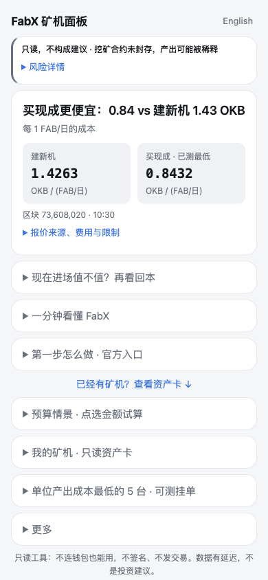

# FabX Miner Desk

[](LICENSE)

[English](README.md) · **中文**

先看清每份日产能要花多少，再考虑入场：在 X Layer 上比较 FabX 建机与买机成本、查看地址矿机产出、试算回本的只读工具。

**[打开在线工具](https://fabx-miner-desk.pages.dev/)** · [FabX DeWeb 镜像](https://r1-dc945fd3aee9829a3c9065459e82aa503572da5f-deweb.fabx.tech/) · [产品范围](PRODUCT.md) · [版本记录](CHANGELOG.md)

本项目是 **X Layer TapeOut 开发者加速计划参赛作品**。

## 你能得到什么

- **入场先比成本**：把新建矿机与官方市场可测挂单放到同一个单位下，比较「每天产出 1 FAB，需要多少 OKB」。
- **有矿机就看资产卡**：输入地址，查看链上确认持有的矿机、待领取奖励、实测日产与重置成本估值。
- **把回本假设摊开**：试算 FAB 涨跌、全网权重增长对产出价值的影响，区分静态年化、回本天数与未来情景。
- **不熟悉也能直接看**：首屏先提示风险，再给建机/买机比较；中英文界面都能在手机上用，不连钱包也能看。
- **每个数有出处**：区块、观察时间、缓存年龄和覆盖范围可查，读不到就保留未知。
- **自定义规则自己填**：默认留空、默认关闭，只保存在本浏览器，不提供预设策略，也不会自动执行交易。

## 怎么工作

首页不需要地址。打开后，工具读取公开合约和参考价格，先比较入场成本；展开「现在进场值不值？再看回本」可继续试算。已有矿机则点「已经有矿机？查看资产卡」，粘贴地址或加载公开示例。

```text
公开链上状态 + 参考价格 → 统一成每 1 FAB/日产能的成本 → 比较建机与官方挂单
地址 → 同一区块核对持有关系 → 约十分钟奖励差分 → 日产与资产卡
```



上图为 **2026-10-19、390 × 844** 的真实浏览器首屏。所有截图中的价格、产出与估值都是当时的示例，不是当前报价；在线版本也可能与本目录不同。另见[英文首屏](docs/screenshots/newbie-mobile-v2-en.png)和[矿机资产卡：公开示例地址、非作者持仓、历史快照](docs/screenshots/asset-card-mobile-v3.png)。

### 读哪些合约

当前接入 **X Layer（chain ID 196）上的 FabX / TapeOut 电路与挖矿系统**，不部署合约。地址配置见 [desk.mjs](desk.mjs) 和 [nand-price.mjs](nand-price.mjs)。

| 合约 / 参考源 | 地址 | 读取方式 |
| --- | --- | --- |
| FabX 挖矿 | `0x4f6a2312d80753bdafd35ddb1bf4bb14c43f8265` | `totalVerifWeight`、`minerCount`、`isSealed`、`minerKey`、`pendingWithDeweb`、`getMiner`、`dewebWeights`、`currentRate`、`UNVERIFIED_BPS` |
| FabX 电路 NFT | `0x87bfca3494aa228ff589ab9b642143a5e8c8f9a6` | 固定区块读取 `balanceOf`、`nextId`、`ownerOf` |
| 官方矿机市场 | `0x0bc37f95ae57bb20e995d425d46d6df9f22bd7a1` | `nextListingId`、`listingView`；完整扫描后才排名 |
| NAND / LATCH 市场 | `0x7f955c233fdb17e98fb26f330d778d3e30fe6ee6` | `nextAskId`、`asks`；按 NAND 集合与 token ID 精确筛选 |
| 创世 NAND 集合 | `0xbe6f94115d32f3ac3252bc4626573e739beeb714` | 卖单簿中匹配 token ID `0` |
| Uniswap v4 PoolManager | `0x360e68faccca8ca495c1b759fd9eee466db9fb32` | 用 `extsload(bytes32)` 读取 FAB/BEM Slot0；可选读取 swap 日志 |
| Multicall3 | `0xca11bde05977b3631167028862be2a173976ca11` | `tryAggregate(false, calls)` 批量只读调用 |
| BEM 价格参考（**BSC**） | `0x3098d7a051045000d68ec0360753a40c8cabea31` | DexScreener 公开交易对的 BEM/USD 报价 |

FAB/BEM 池 ID：`0x63556b8d29b7ada6effae8b336cb806a06caf6546b33059b1e5e8b93a98cb29d`。

状态读取走公共 X Layer RPC；可选 swap 日志走单独的公共端点。BEM/USD 来自 DexScreener；OKB/USD 使用 OKX 公开 OKB-USDT 行情近似。浏览器直接在链上发现并核对持有关系；Node 调用方可用 FabX 公开 API 获取候选 ID，但仍须链上验证。

### 数字怎么算

| 显示项 | 口径与边界 |
| --- | --- |
| FAB 参考价 | Slot0 中的 FAB/BEM × BEM/USD。两种币均为 8 位小数，currency0 为 BEM，因此每 FAB 对应的 BEM 为 `1 / (sqrtPriceX96 / 2**96)**2`。这是参考价，不是可成交报价。 |
| NAND 价格 | 完整解码 NAND 卖单簿后取最低正数未成交卖价，同时显示该价位数量。手动价、缓存价单独标识；深度未必够重建全部矿机。 |
| 矿机日产 | 约十分钟内的 `pendingWithDeweb` 差分 × `86400 / 实际间隔秒数`。窗口内领取、哨兵值、缺历史、状态变化或速率核对失败均保留未知。 |
| 待领奖励 | 只有持有关系发现完整且全部矿机的当前 pending 都读取成功，才显示总额；否则显示「已读待领小计」及 `n/m 台`，或未知。待领覆盖率独立于日产可测率。 |
| 新建成本 | 与挂单在同一区块读取链上 `currentRate`（产量 reader 的 `emissionRate`）和 `UNVERIFIED_BPS`（`unverifiedBps`），按合约整数分配规则及 FAB 的 8 位小数换算实际已验证 FAB/日；每个 NAND 等效 600 验证权重。为新增 1 FAB/日产能，需要 `networkNand / (verifiedFabPerDay - 1)` 个 NAND，已计入新增权重自身造成的稀释。读不到实际排放时标记「假设未核实」，不给出更便宜的结论。实际建机要取离散数量，也可能有其他费用。 |
| 挂单单位成本 | 官方挂单的 OKB 价格 ÷ 实测 FAB/日，不扣除待领取奖励。 |
| 资产价值 | 把实测产能换算成 NAND 等效数量，再按重建成本估值；不是买入成本，也不是二手转售价。只合计已发现且产出可测的矿机。 |
| 年化 / 回本 | 根据当前产出、参考价格与模型成本计算静态毛估值，不含未来稀释、手续费、gas 和价格变化。未来产出情景会标明未实测的增长假设。 |

入场建机/买机比较按上面的实际排放计算。资产重置估值、全网份额及单独的静态回本/产出情景仍假设已验证排放为 7,128 FAB/日（7,200 × 99%）；该假设不是当前链上排放的证据。

挂单必须枚举完整后才能排名。地址查全的条件是：同一区块下，去重后经 `ownerOf` 确认的数量等于 `balanceOf`；不完整就标明部分覆盖。缓存保留原观察时间及价格来源。

## 安装

```sh
git clone https://github.com/runesleo/fabx-miner-desk.git
cd fabx-miner-desk
```

也可以下载源码压缩包。项目由静态 HTML 与原生 ES modules 组成，无需安装 npm 包、无需构建，也没有应用后端。

**交给任意 AI 编程助手维护时**：先读 [PRODUCT.md](PRODUCT.md)、上面的合约与数据口径，再看 [test/](test/)。只读自检命令是 `node --test`，不依赖特定 Agent 框架。

## 环境要求

- 支持 ES modules、`fetch` 和本地存储的现代浏览器。
- Python 3 或其他静态 HTTP 服务器；不要用 `file://` 直接打开页面。
- 跑离线测试或可选在线诊断时需要 Node.js 22+，不需要 npm 依赖。
- 读取实时数据需要联网访问公共 RPC 和价格接口，不需要 API key 或钱包插件。

**隐私说明**：这是只读工具，不连钱包也能用，不签名、不授权代币、不发交易。地址只用于读取公开链上数据。可选的钱包按钮仅在用户点击后调用 `eth_requestAccounts` 获取地址；粘贴地址或使用公开示例无需钱包插件。

工具没有应用后端，但公共 RPC/API 服务商会收到查询所需的信息，包括适用时的地址，以及正常连接元数据。偏好、自定义规则、缓存观察值和上次使用的非示例地址存放在浏览器 local storage 中，清除站点数据即可移除；示例地址不会保存为你的上次地址。

`/?address=0x…` 和 `/rigs?address=0x…` 可直接打开地址查询。这类链接会先到静态托管服务，再由页面清除查询参数；不希望地址出现在初始 URL 请求里时，请手动粘贴。普通查询切换到 `/rigs`，URL 不附地址。复制或托管时保留 `rigs/index.html` 指向主页的相对软链接。本仓库未配置统计 beacon；在线托管可能注入 Cloudflare Pages Web Analytics 等统计功能。

内置地址 `0xe0cb3d9542a786c60605dd55efb9ef79490a3d6c` 是公开示例地址，非作者持仓；资产卡截图是该示例的历史快照，不代表当前余额。截图和测试样本可能包含公开市场活动及示例余额。工具不需要私钥、助记词或任何凭证，计算结果不构成投资建议。

## 快速开始

在项目目录执行：

```sh
# 离线自检，不访问真实服务或钱包。
node --test

# 启动静态服务器，保持此终端运行。
python3 -m http.server 8765 --bind 127.0.0.1
```

打开 **http://127.0.0.1:8765/**，不用填地址就能看入场比较。想了解资产卡，可以展开「已经有矿机？查看资产卡」并加载公开示例。

需要主动检查在线数据源时，可另行运行以下**只读、联网**诊断；它们不属于离线测试：

```sh
node scripts/live-check.mjs
node scripts/live-check.mjs --chain-only
```

第二条禁用可选的 FabX 候选 ID API，检查链上发现路径。在线检查受服务可用性影响；Node 不执行浏览器 CORS 限制，不能用它代替真实浏览器验收。

## 已验证

| 场景 | 环境 | 结果 |
| --- | --- | --- |
| 2026-10-19 本次重跑的离线测试 | macOS，Node.js 25.9.0，`node --test` | **156 通过、0 失败、0 跳过** |
| 2026-10-19 已有真实浏览器实测 | Chrome + 本地静态服务器；中英文；390 × 844 与 320 × 844 | 均无横向溢出；390px 下，风险短句、两张成本卡及九个折叠标题均在首屏。一次点击可打开回本，公开示例查询可用。 |
| 同次浏览器只读检查 | Chrome | 钱包请求 0 次、运行时异常 0 个；仅观察到 `eth_blockNumber`、`eth_call`、`eth_getBlockByNumber`、`eth_getLogs`。 |
| 2026-10-19 已有资产卡实测 | Chrome，390 × 844，中英文，公开示例地址 | 当次 76 台矿机中 76 台可测；无横向溢出，无钱包请求。 |
| 2026-10-19 审查修复后重截资产卡 | Chrome，390px 视口；中文公开示例卡，PNG 为 390 × 1032 | 图片内保留示例地址、非作者持仓及历史快照说明，单独显示待领覆盖率；只截网页内容。 |

离线测试使用替身 provider 和固定样本，覆盖计算、持有关系、错误、超时、缓存和界面行为。除审查修复后重截资产卡外，上表浏览器结果来自此前开发实测，本次未重跑完整浏览器尺寸矩阵。保留的三张截图都是历史快照，不代表此刻的服务健康。320px 验证的是不横向溢出，不保证全部内容都在一屏；字号、较长价格及缓存/手动价提示可能增加高度。

## 已知限制（v0.1）

- **只覆盖 FabX 官方矿机市场**：不含 Firsto 独立签名挂单、其他市场及其他链的 TapeOut 矿机。「可测最低」不等于全市场最便宜，也不是买入建议。
- **短窗口不能代表未来**：约十分钟奖励差分折算为日产；领取、缺历史或状态/速率变化会使结果未知。当前可测不意味着以后维持同样产出。
- **公共 RPC 会限流**：历史状态不可用、扫描上限和超时也可能导致缺数。可选的 24 小时 swap 历史失败不阻塞核心状态；暂未接入 LATCH 价格。
- **建机未计完整费用与 gas**：模型按 NAND 等效产能及新增权重稀释估算，不覆盖所有建机开支；实际数量要取整，最低卖价也未必有足够深度。静态年化、回本还排除了未来稀释、费用与币价变化，可能始终无法回本。
- **挖矿合约未封存**：2026-10-19 截图中状态为未封存；工具通过 `isSealed` 读取并标注观察时间。合约可升级，未封存期间新增处理器可能稀释产出；当前观测状态请刷新页面查看。

## 路线图

**覆盖范围**
- [ ] 在现有 FabX 接入之外，支持 TapeOut 官方矿机，并逐项说明链与市场范围。

**矿机估值**
- [ ] 引入更长的产出观察、挂单深度，进一步区分重置成本与转售估值。

**部署与使用**
- [ ] 支持 DeWeb 部署，补齐静态托管使用说明。

## 关于作者

*Leo（[@runes_leo](https://x.com/runes_leo)）— AI × Crypto 独立构建者。在 [Polymarket](https://polymarket.com/?via=runes-leo&r=runesleo&utm_source=github&utm_content=fabx-miner-desk) 做量化，用 Claude Code 和 Codex 搭数据与内容管线。*

*[leolabs.me](https://leolabs.me) — 写作 · 社群 · 开源工具 · 独立项目*

*[X 订阅](https://x.com/runes_leo/creator-subscriptions/subscribe) — 付费内容周刊*

*Learn in public, Build in public.*

## License

MIT — 见 [LICENSE](LICENSE)。Copyright (c) 2026 Leo Labs.
